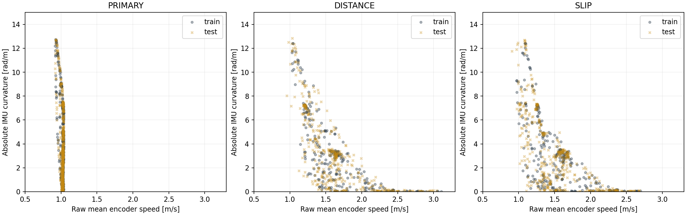
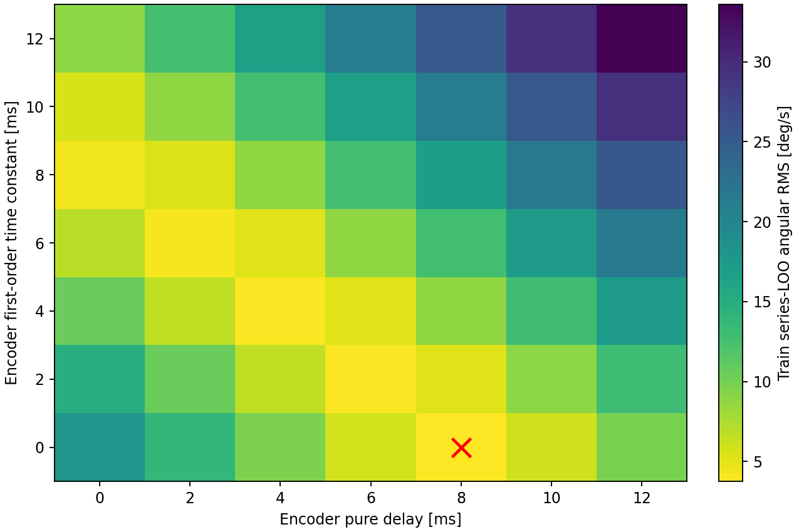
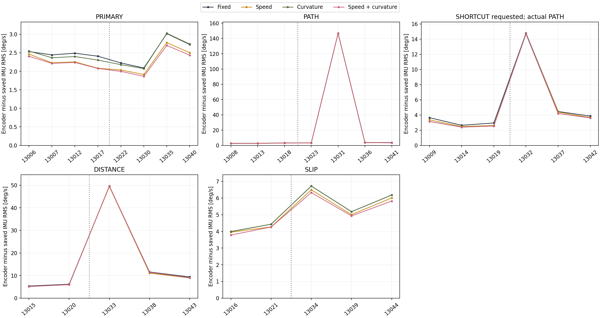
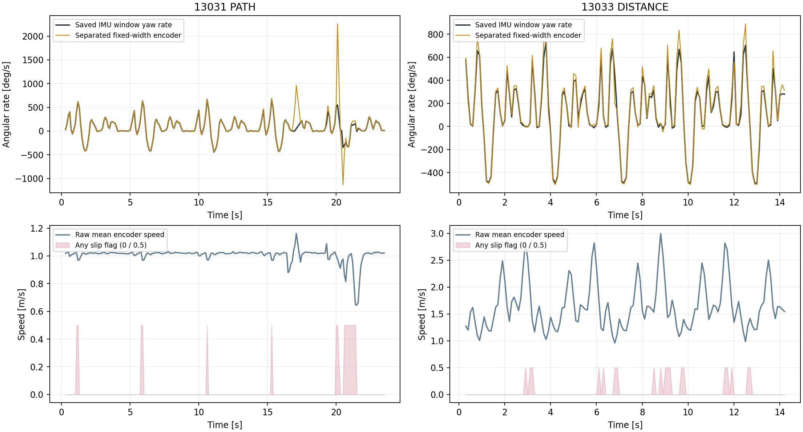

# 複数速度・曲率ログでの時間応答／左右換算差／実効幅の分離検証

結論: 31ログに拡張し、時間応答を先に選定、左右換算差を直線と定常旋回から推定して固定、その後にモード別の幅モデルを比較した。時間応答と左右差の扱いによる改善が大きい。速度・曲率依存の追加効果はDISTANCEでは小さく、SLIPではtest3本すべてで小幅な改善がある。全体へ共通の可変幅を採用する根拠は得られていない。

## 対象・系列分離

- 同一gitCommit=8be46b1、buildDate=Oct 4 2026、buildTime=23:27:00の正常終了31本。train14本、test17本。期待行数・必要列・IMU校正・原データSHA256を確認した。
- trainの一次ログ系列=13006/13007/13012/13017、test系列=13022/13030/13035/13040。同じ一次ログに続くPATH、SHORTCUT要求、DISTANCE、SLIPを同じ側へ割り当て、系列を跨ぐ情報漏れを防ぐ。
- PRIMARY 8本、PATH 7本、SHORTCUT要求6本、DISTANCE 5本、SLIP 5本。SHORTCUT要求ログの実optimalTraceは4（PATH）であり、実SHORTCUTとしては扱わない。DISTANCE/SLIPもrequestedModeで分けて評価する。
- 緊急停止ログは除外。13006はclosureValid=0だが正常終了・距離検証成功なので相対センサー解析にのみ含む。二次ログのdistanceScaleVerified=0は一次ログ限定の検証項目のため、その値だけで除外せず、紐づく有効一次ログの距離検証成功を確認した。
- testの一次ログは以前から確認済み。今回のモデルはtrainだけで選定・固定したが、既存ログの探索的検証であり、新規収集した独立実機testではない。電圧は約7.4～8.3V、trainとtestで走行順・電圧が交絡する。
- 非重複100ms窓はtrain 2834、test 3352、計6186。開始0.25秒と終了0.15秒以上を除外。13031の最大15msの行間隔を含む4窓は時間補間精度不足として除外し、残る同ログは評価に含めた。行間隔は距離基準ログなので、15msだけを根拠に行落ちとは断定しない。
- 速度は左右生累積Encoderの平均から求める。SLIPのencTotalOptimalに含まれる距離補正を速度へ混ぜない。CROSS姿勢・CROSS位置とも今回の解析に使わない。疎なgyroVal_Zは再積分しない。

## 分離するモデル

```text
Cdiff = (encTotalL - encTotalR)/58.019       [mm]
Cavg  = (encTotalL + encTotalR)/(2*58.019)   [mm]
Ctilde(t) = first_order_filter_T(C(t - delay))
dtilde = ΔCtilde_diff/Δt                   [mm/s]
vtilde = ΔCtilde_avg/(1000*Δt)             [m/s]
ω_IMU  = Δ(saved imuAngle_Z)/Δt            [rad/s]
B(v,κ) = B0 + Bv*(v - 1.5)/1.0 + Bκ*|κ|/5 [mm]
dtilde = B(v,κ)*ω_IMU + c*vtilde + c0
κ = ω_IMU/v                               [rad/m]
ω_encoder = (dtilde - c*vtilde - c0)/B(v,κ)
```

- ステップ1: trainで遅れ0～12ms・一次遅れ時定数0～12msを各2ms刻みで探索。各モード固有の定数Bと共通のc/c0を補助変数として推定し、一次ログ系列単位LOOの角速度残差を、モード・ログ等重みで比較した。
- ステップ2: 応答を固定し、直線相当（|ω|<10deg/s、|dω/dt|<100deg/s²、滑りフラグなし）でc/c0を、定常旋回（|ω|≥30deg/s、|dω/dt|<300deg/s²、滑りフラグなし）でモード別Bを交互に5回推定。幅の可変係数へ左右差を吸収させないよう、以降の全幅モデルでc/c0を共通固定した。
- ステップ3: モード別に固定幅・速度依存・曲率依存・両方を比較。正則化はtrainの系列LOOで0/0.01/0.1/1から選定。このLOOは共通校正を全trainから固定した条件付き評価で、全校正手順を再学習する完全な外側CVではない。最終testは系列全体を保持して評価する。
- Encoder累積値を1msの数値格子へ線形補間して応答モデルを計算する。元の1msサンプルを復元した主張ではない。IMU角度の差分は保存値から直接計算する。
- 観測モデル上では時間応答・左右差・幅の項を分けたが、独立Yaw基準がないため、物理的な車輪径差・接地滑り・gyro誤差を一意に分離した校正ではない。

## 時間応答・左右差の結果

- 選定された共通応答はEncoder側の純遅れ8ms、一次遅れ時定数0ms。系列LOO RMSは3.7692deg/s。gyroのハードウェア遅延が8msと確定した意味ではなく、センサー・機械・補間を含む相対応答近似。
- 前解析の「未来IMUへ+10ms移動」と異なり、今回の純遅れは過去のEncoder区間を現在IMU区間へ対応させる。構造としては過去データで計算できるが、実時間EKFへの適用・遅延観測処理は未実装。
- trainモード別の応答感度では、PRIMARY/PATHは遅れ6ms＋時定数2ms、SHORTCUT要求/DISTANCE/SLIPは純遅れ8msが最小。共通の8msは完全なセンサー伝達関数ではない。
- 分離推定した c=8.929797mm/m（左右差に約0.8930%相当）、c0=-2.261084mm/s。直線370窓、定常旋回288窓から推定。高速の直線はDISTANCE 4窓・SLIP 12窓と少ない。
- 平均換算を保つ左右スケール補正に形式的に換算すると左0.99553510、右1.00446490に相当する。ただし実機の校正値として採用せず、コードへ反映しない。
- 系列を1つずつ外したcは8.350～9.072mm/m。直線判定条件を変えると7.294～9.087mm/mとなり、精密な物理校正値とは扱えない。
- c0は残る定数不整合を吸収する項で、gyro biasや車輪センサーoffsetそのものとは同定できない。固定係数のままc0だけを外す診断ではtestが改善するモードがあり、この項の汎化も不十分。診断を根拠にtestへ合わせた係数の再選定はしていない。

## 別系列test・100ms窓の結果

保存IMUに対する角速度残差RMS [deg/s]。固定幅も今回のtrainでモード別に再推定した値であり、現行EKFの117.8375mmの直接評価ではない。

| モード | 固定幅 | 速度依存 | 曲率依存 | 速度＋曲率 |
|---|---:|---:|---:|---:|
| PRIMARY | 2.5418 | 2.3325 | 2.5340 | 2.2742 |
| PATH | 73.4459 | 73.4354 | 73.3250 | 73.3266 |
| SHORTCUT要求・実PATH | 9.1799 | 9.0904 | 9.0559 | 9.0558 |
| DISTANCE | 29.8717 | 29.6979 | 29.8694 | 29.8774 |
| SLIP | 6.0607 | 5.8683 | 6.0609 | 5.7195 |

- DISTANCEの速度依存は固定幅から0.58%低下。曲率を加えても改善しない。SLIPの速度＋曲率は5.63%低下し、13034/13039/13044の3本すべてで改善。
- 幅の候補はB0=PRIMARY 112.5236、PATH 112.6613、SHORTCUT要求112.8153、DISTANCE 112.0732、SLIP 112.0993mm。すべて保存IMUとこの時間応答・左右差モデルに対する相対値で、物理トレッドや実機採用値ではない。
- SLIPの速度＋曲率モデルはB0=111.6110mm、Bv=+3.4628mm/(m/s)、Bκ=+0.9220mm/(5rad/m)。testでの予測幅は110.2588～115.7071mm。DISTANCEの速度依存はBv=+1.4982mm/(m/s)。低速PRIMARYの速度係数は負であり、モード共通の単純な速度依存とは結論できない。

### 高速モードのログ別再現性

| ログ | モード | 固定幅 RMS [deg/s] | 速度＋曲率 RMS [deg/s] |
|---|---|---:|---:|
| 13033 | DISTANCE | 49.5431 | 49.6493 |
| 13038 | DISTANCE | 11.5897 | 11.4288 |
| 13043 | DISTANCE | 9.3870 | 9.0725 |
| 13034 | SLIP | 6.7180 | 6.3248 |
| 13039 | SLIP | 5.1824 | 4.9283 |
| 13044 | SLIP | 6.1812 | 5.8177 |

## 大きな不一致と原因の未確定事項

- 13031(PATH)は固定幅残差146.7582deg/s。20.055～20.155秒では平均前進速度約0.977m/s、左右差速度約4453mm/s、IMU角速度約550deg/sに対し、Encoder換算角速度は約2260deg/sとなる。幅を数mm変えるモデルでは説明できない。
- 13031は後半の局所的な不一致、13033(DISTANCE)は固定幅残差49.5431deg/sで角速度ピーク等の不一致がある。いずれも正常終了なので主評価に含める。滑りフラグなしでも大きい残差があり、フラグだけでは全不一致を検出できない。
- IMU.cのYawはgyro積分のみで、参照した現行コードにPATHからimuVal.angle.zを書き換える処理は見つからなかった。元ログの保存Yaw区間差と瞬時gyroも調べたが、疎な瞬時gyroとの局所差だけでYaw破損とは断定しない。接地滑り、車輪回転と機体旋回の乖離、Encoder系、IMU系のどれが原因かは実機・独立基準での確認が必要。
- 13030系列のPATH/DISTANCEの大きな残差は可変幅へ吸収させて解決できない。系列を除外して改善した数値を主結果としては使わない。

## 窓長・構成要素の感度

- 40/200ms窓でも時間応答・左右差と正則化強度を固定し、幅係数だけtrainで再推定した。SLIPの速度＋曲率は40msで8.292→8.032deg/s、200msで5.003→4.671deg/sと小幅改善。DISTANCEの大きな不一致は窓長を変えても残る。
- 同じ幅係数・c/c0のまま時間応答だけをOFFにすると、testのPRIMARYは2.542→12.123deg/s、SLIPは6.061→23.334deg/sへ悪化。今回の相対角速度モデルでは時間応答の寄与が可変幅の寄与より大きい。
- 同じ幅係数のままcとc0を両方OFFにすると、PRIMARYは5.205deg/s、SLIPは10.830deg/s。c0だけOFFではそれぞれ2.215/5.490deg/sと改善する。校正の定数項を実機へ持ち込む根拠は得られていない。
- 覆い窓の積算角度差もCSVへ保存。例えばPRIMARYの固定幅はtest全窓でRMS31.36°、SLIPは50.90°、速度＋曲率SLIPは47.43°で、長時間積算の整合性も十分とはいえない。この指標は正確な周回境界の閉路や独立Yaw精度ではない。

## 何が確認でき、何が残るか

- 確認できた: モード別の複数速度・複数曲率ログで、相対時間応答・共通左右差項を固定した後にもSLIPで可変幅の小幅な改善が再現した。
- 未確認: 物理的な幅の速度依存／曲率依存の一意な分離、独立Yaw精度、全モード共通係数、可変幅を入れたEKF全体のXY・閉路改善、実機の時間同期や滑り原因。
- 高速ほど直線、低速ほど急旋回という速度計画の相関が強い。複数速度を含むが、速度×曲率を独立に変えた実験ではない。DISTANCE/SLIPのtrainは各2本・test各3本で、電圧条件も異なる。
- 結論: 現行EKFとファームウェアは変更しない。次の解析候補は、時間応答を合わせたEncoder角速度観測と左右差の速度比例項。固定定数offsetと可変幅は診断候補に留める。実機の物理校正には追加の独立基準を用意する。

## 図






## 再現・検証

```powershell
python analysis/script/analyze_multispeed_width_13006_13044.py
python analysis/script/diagnose_multispeed_width_13006_13044.py
python analysis/script/validate_multispeed_width_13006_13044.py
```

- 146263元行、31ログ、6186窓、124モデル別ログ指標、24744予測行を照合。元CSVから左右を別々に補間して純遅れ区間・速度・IMU角速度を独立再計算。入力差分の最大差8.88e-11、角速度RMS差2.7e-12deg/s。
- 元CSV、固定パラメータ、解析ソースのSHA256不変、系列分離、非重複窓、係数名集合、幅範囲70～200mm、速度×曲率カバレッジ集計、一次遅れ畳込みと逐次IIRの一致を確認。
- 4図を目視確認。モード内比較図は全データを収容し、外れログを表示した。元CSV・既存EKF・ファームウェア・SD設定を変更していない。ビルド・書込み・走行は実施していない。
